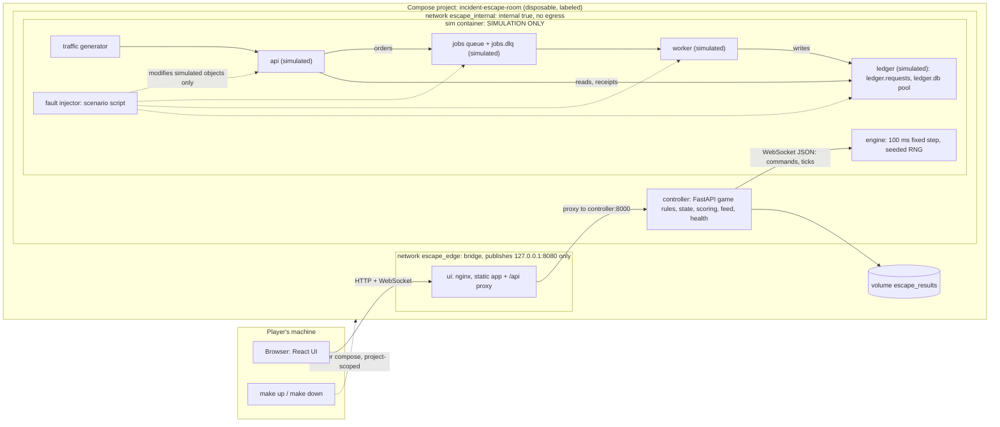
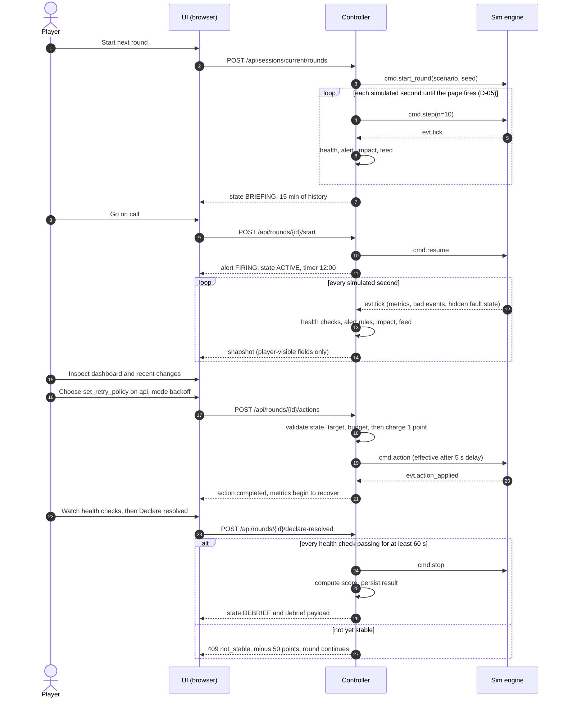
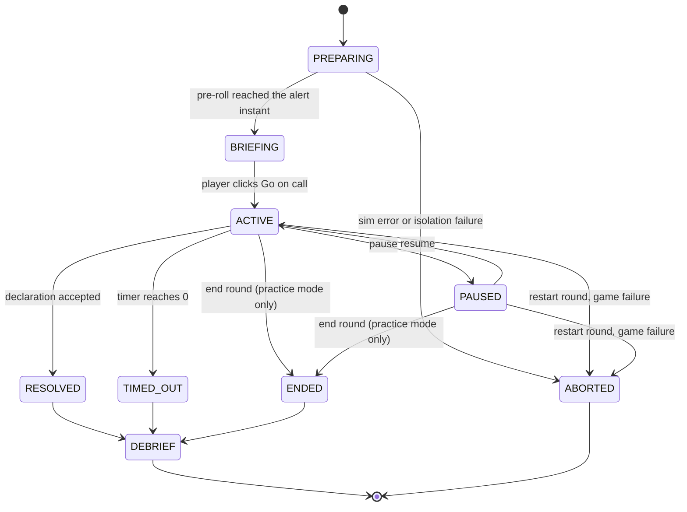

# Incident Escape Room: Technical Design Document

| | |
|---|---|
| **Status** | Draft for estimation and implementation kickoff. Revised with the decision addendum (§18). |
| **Scope** | First playable version (MVP). Stretch goals are labeled and kept out of scope |
| **Audience** | The sole developer, who is also the product owner, designer, tester, and approver (D-19) |

> **🛡️ Safety guardrail (hard requirement).** All fault injection and experiments run only inside a disposable, project-scoped environment that the person running it owns and controls, on their own machine. The "services" that break are simulations inside that sandbox. Nothing in this design connects to, targets, or reconfigures real, shared, public, or uncontrolled systems. No component offers a way to point the game at anything else. Section 5 lists the safeguards. Every later section points back to the safety requirements (SR-*) that it implements.

**How to read this document.** Each item is labeled as one of three kinds:

- **Requirement:** a must-have, with an ID such as FR-3 or SR-2.
- **Design choice:** a decision we made, with the reasoning behind it.
- **Assumption:** something we believe but have not yet confirmed.

Values marked *(default)* are starting points for tuning during playtests.

---

## 1. Executive summary and goals

**Product.** Incident Escape Room is a single-player browser game that runs entirely on the player's computer. It simulates a small online store, the fictional *Larkspur Goods*, which has three services: `api`, `worker`, and `ledger`. A background job queue (`jobs`) connects `api` and `worker`. The player is the on-call engineer. In each round a hidden fault breaks the system, an alert fires, and a 12-minute timer starts. The player reads the dashboard, works out what is wrong, spends a limited change budget on fixes, confirms that the fix holds, and declares the incident resolved. A debrief then reveals the root cause and the score.

**Target player.** Engineers who are new or fairly new to on-call, plus curious product and design teammates. They can read a basic dashboard but have no deep SRE experience. Every metric, action, and rule is explained in the interface itself.

**Goals**

1. Teach four skills through play: observability design, failure isolation, incident response, and recovery verification.
2. Reward judgment over speed. A well-reasoned targeted fix must beat a reflexive "restart everything."
3. Make every scenario solvable from the evidence on screen, so that success never depends on luck.
4. Be safe by construction: one command creates the disposable environment, another removes it, and the environment cannot reach real systems.

**MVP boundary (in scope)**

- Three simulated services, a simulated job queue, and a traffic generator.
- An observability dashboard with five metric families for each service, health checks, one paging alert, and a short "recent changes" list.
- Three hidden scenarios, one per round: `pool_leak`, `poison_message`, and `retry_storm`.
- A fictional customer-impact feed driven by simulated bad events.
- A seven-action catalog with a change budget of 12 points per round.
- Player-declared resolution with a 60-second stability rule.
- A transparent score out of 1,000 and a debrief after each round.
- `make up` and `make down`.

**Deliberately excluded from the MVP**

- **Stretch goals:** player-facing seeded scenario replay, and a post-game timeline that overlays actions on metrics with helped/hurt/no-effect markers. Section 16 lists the extension points prepared for both.
- Accounts, leaderboards, multiplayer, cloud hosting, telemetry and analytics.
- Real logs and traces, Grafana or Prometheus as the player-facing tool, a scenario editor, more than three scenarios, and mobile layouts.
- Any feature that targets systems outside the sandbox. This is excluded permanently, not deferred.

---

## 2. Requirements

### 2.1 Functional requirements

| ID | Requirement |
|---|---|
| FR-1 | A session contains three rounds, one for each scenario, in random order. Each scenario appears exactly once. |
| FR-2 | Each round has a briefing, an active incident phase with a 12-minute timer *(default)*, and a debrief. Practice mode replaces the countdown with elapsed time (D-02). |
| FR-3 | The simulation models `api`, `jobs`, `worker`, and `ledger`, driven by a traffic generator producing steady, believable load. |
| FR-4 | The dashboard shows latency, error rate, throughput, queue depth, and connection-pool usage for each service, wherever the metric applies (§9). |
| FR-5 | One paging alert starts the round timer. Alert text describes the symptom, never the cause. |
| FR-6 | A customer-impact feed shows fictional complaints and counters derived only from simulated bad events (§9.5). |
| FR-7 | The player can run the actions in the catalog (§10). Each action has a cost and is charged against a budget of 12 points per round. |
| FR-8 | Restarting everything restores service in every scenario but scores worse than the targeted fix (§11). |
| FR-9 | The player declares the incident resolved. The declaration is accepted only if every health check has passed continuously for the stability window (60 s *(default)*). |
| FR-10 | The debrief shows the outcome, the root cause, time to detect, time to recover, every action with its cost and penalty, and a score breakdown. |
| FR-11 | The player can pause, restart a round, or reset the whole session. |

### 2.2 Non-functional requirements

| ID | Requirement |
|---|---|
| NFR-1 | Runtime needs no internet access, accounts, or cloud services. Only the first build needs network access, to fetch base images and pinned dependencies. |
| NFR-2 | The dashboard updates at 1 Hz. Actions are acknowledged in under 200 ms. One 100 ms simulation step computes in under 20 ms at 4× baseline load. |
| NFR-3 | The full stack uses no more than 1 CPU core and 600 MB of RAM. It runs on a laptop with 8 GB of RAM. |
| NFR-4 | A warm `make up` reaches "ready" in 60 s or less. A cold `make up`, including image builds, takes 5 minutes or less on typical broadband. |
| NFR-5 | Given the same seed and the same timed actions, the simulation produces identical output. This is for automated tests and is not a player feature. |
| NFR-6 | The UI supports current Chrome, Firefox, Edge, and Safari at 1280×800 or larger. |

### 2.3 Safety requirements

These are hard requirements. If any of them fails, the game must stop: it refuses to start rounds rather than continue in a degraded mode. Section 5 describes the design.

| ID | Requirement |
|---|---|
| SR-1 | All game components run inside one Compose project named `incident-escape-room`. Every resource carries the label `com.incident-escape-room.managed=true`. |
| SR-2 | The simulation and the game controller attach only to an internal network (`internal: true`) that has no route to the host network or the internet. |
| SR-3 | No container uses host networking, privileged mode, added capabilities, devices, the Docker socket, or host PID/IPC namespaces. |
| SR-4 | No host bind mounts in player mode. Containers run with read-only root filesystems plus small tmpfs mounts. |
| SR-5 | No credentials or cloud configuration are passed in. Startup checks reject known credential environment variables and config paths. |
| SR-6 | Fault injection exists only as scenario logic inside the `sim` process. It acts only on simulated in-memory objects. |
| SR-7 | Action targets come from a closed server-side list (`api`, `worker`, `ledger`, `jobs`). No API accepts a free-text hostname, URL, IP address, or path. |
| SR-8 | The only published port is `127.0.0.1:8080`, which serves the UI. Nothing listens on other host interfaces. |
| SR-9 | Isolation checks run at `make up` and again at controller startup. If any check fails, the game fails closed (§5.6). |
| SR-10 | The UI and documentation state that everything is a local simulation and never instruct players to inject faults elsewhere. |

### 2.4 Accessibility and usability requirements

| ID | Requirement |
|---|---|
| AR-1 | Meet WCAG 2.2 AA: contrast, focus visibility, and full keyboard operation. |
| AR-2 | Never use color alone for state. Statuses pair an icon, a text label, and a color. Chart palettes are safe for color-vision deficiency. |
| AR-3 | Every chart has a text summary and a "view as table" option. The alert uses an assertive ARIA live region. Feed and action updates use polite regions, limited to one announcement every 10 s. |
| AR-4 | Pause is always available during the active phase. Reduced-motion settings disable animations. Text scales to 200% without loss of content. |
| AR-5 | Every metric and action has a plain-language tooltip, for example "p95 latency: 95% of requests were faster than this." The briefing explains the rules in about a minute of reading. |

### 2.5 Operational requirements

| ID | Requirement |
|---|---|
| OR-1 | `make up` creates and verifies the environment. `make down` removes every resource of this project and nothing else (§4.7). |
| OR-2 | `make status`, `make logs`, and `make test` are available. All output stays on the local machine. |
| OR-3 | Both `make up` and `make down` are safe to run repeatedly. |
| OR-4 | The UI footer shows the build version and scenario-pack version, so playtest results can be traced to a build. |

### 2.6 MVP success criteria mapped to acceptance tests

| # | Success criterion | Acceptance test | Pass threshold |
|---|---|---|---|
| SC-1 | A new player can finish all three scenarios in one session, at roughly 15–20 minutes each | *(Revised per D-19; no other players are available.)* (a) Design bound: a round lasts at most 12 min (timer) + about 2 min (briefing) + about 3 min (debrief). (b) Developer self-play timing on fresh seeds, recorded as a lower bound. New-player timing is an **accepted validation gap**. | (a) Holds by construction and test. (b) Median self-play round ≤ 20 min. |
| SC-2 | Each failure can be diagnosed from the dashboard without guessing, and the three are clearly distinguishable | (a) Automated test T-DIAG (§15): a rule-based classifier that reads only the player-visible stream classifies 3 scenarios × 50 seeds. (b) *Proxy for expert review (D-16):* three fresh AI sessions with no project context classify from console screenshots taken 90 s after the alert. (c) Other players' first actions: **accepted validation gap** (D-19). | (a) 100% correct by alert + 60 s. (b) ≥ 8 of 9 classifications correct (component and mechanism). |
| SC-3 | In every scenario, a targeted fix scores better than restarting everything | Automated test T-SCORE (§15): scripted policies on 50 seeds × decision times {30, 60, 120, 240} s, plus a fairness case comparing restart-all at 20 s with the targeted fix at 180 s. | Targeted scores higher than restart-all in 100% of cases, with a median margin of 250 points or more. |
| SC-4 | Most playtesters can explain the root cause afterward | *Proxy (D-16, D-19):* for each scenario, a fresh AI session given only the debrief text must restate the failing component and mechanism. The real-player check is an **accepted validation gap**. | 3 of 3 correct. |
| SC-5 | One command creates the environment, another removes it, and the environment stays isolated | Automated tests T-UP, T-DOWN, and T-ISO (§15) on a clean CI runner, with sentinel resources that are not part of the project. | `make up` exits 0 with health and isolation checks green. `make down` leaves zero labeled resources and the sentinels untouched. No packets leave the internal network. |

---

## 3. System architecture

### 3.1 Components

**Components that run the game:**

| Component | Container | Responsibility |
|---|---|---|
| UI | `ui` | An nginx server (unprivileged image). It serves the built React/TypeScript app and reverse-proxies `/api` and the WebSocket to `controller`. It holds no game logic. |
| Game controller | `controller` | Python 3.12 + FastAPI. It owns the session and round state machine, timers, action validation and budget, health checks, alerts, the impact feed, scoring, and the debrief. It strips hidden simulation fields before sending anything to the UI. It is the only component that talks to `sim`. It also writes completed round results to the `escape_results` volume. |

**Components that are game simulations** (all inside the `sim` container):

| Component | Responsibility |
|---|---|
| Simulation engine | A deterministic fixed-step loop (100 ms steps). Owns the simulation clock and the seeded random number generator. |
| Traffic generator | Produces customer requests: reads, receipt exports, and orders (§8). |
| `api` (simulated) | The customer-facing service. Answers reads by calling `ledger`. Accepts orders and places them on `jobs`. |
| `jobs` (simulated queue) | A FIFO queue with redelivery and a dead-letter list (`jobs.dlq`). |
| `worker` (simulated) | Takes orders from `jobs` and writes them to `ledger`. |
| `ledger` (simulated) | The data service. It has a request queue (`ledger.requests`) and a database connection pool (`ledger.db`). |
| Fault injector | Applies the active scenario's script to the simulated objects above, and nothing else (SR-6). |

**Design choice: one simulation process instead of three service containers.** The three services are separate modeled actors. Each has its own state, configuration, status, and restart behavior, but they all run in one `sim` process. This departs from a literal reading of "three small services" for four reasons:

1. **Determinism.** Tests can run a 12-minute round in a few seconds with identical results (NFR-5).
2. **Smaller attack surface.** Restarting a "service" is a state reset inside the model. Real container restarts would require giving the controller access to the Docker socket, which would violate SR-3.
3. **Easier tuning.** Scenario dynamics such as leak rate and retry amplification are explicit parameters rather than side effects of real networking.
4. **Cheaper to build** for a single developer.

The trade-off is that we lose real network effects such as kernel queues and TCP behavior. We model latency, timeouts, pools, and queues explicitly instead. Players see the same metrics either way.

### 3.2 Protocols and boundaries

- **Browser ↔ `ui` (HTTP and WebSocket on `127.0.0.1:8080`).** Static assets, the REST API at `/api/*`, and a live stream at `/api/rounds/{id}/stream`.
- **`ui` ↔ `controller`.** The nginx proxy to the hard-coded upstream `controller:8000`. Proxy targets cannot be configured from the UI.
- **`controller` ↔ `sim`.** One persistent WebSocket to the hard-coded address `ws://sim:9000/link`, carrying JSON messages: commands from the controller, events from the simulation, and a 1 Hz heartbeat. The controller checks that `sim` resolves to an address inside the internal subnet (SR-2).
- **`sim` is a server only.** It contains no outbound networking code; a lint rule enforces this, and test T-ISO-3 checks it. Its only peer is the controller.
- **Trust boundary.** Snapshots from `sim` contain hidden fields: `fault.active`, `fault.neutralized`, and the scenario id. The controller drops these from everything it sends to the UI until the debrief (test T-SPOIL).

### 3.3 Data flow, once per simulated second

1. The `sim` engine runs 10 steps. In each step it applies actions due at that step, generates traffic, processes the services, applies fault dynamics, and records bad customer events.
2. At each 1-second boundary, `sim` sends `evt.tick`: metric samples, bad-event counts by category, service statuses, and the hidden fault state.
3. The controller evaluates health checks and alert rules, adds to impact accounting, generates feed items, updates the round state, and broadcasts a filtered `snapshot` to the UI.
4. The UI renders charts, statuses, and the feed.
5. Player actions go through `POST /api/rounds/{id}/actions`. The controller validates the action, charges the budget, and sends `cmd.action` to `sim`. The action takes effect at the next step boundary plus the action's execution delay.

### 3.4 Architecture diagram



`ui` is attached to both `escape_edge` and `escape_internal`. `controller` and `sim` are attached only to `escape_internal`.

### 3.5 Sequence of one complete round



---

## 4. Runtime and environment

### 4.1 Host prerequisites (assumption)

- Docker Engine **28.0** or later, with the Compose plugin v2.20 or later (for `--wait`) and buildx, running on this computer. Tier-1 (verified) hosts: Linux with Docker Engine, and macOS with Colima. Untested: Docker Desktop on macOS or Windows, and Docker Engine inside WSL2; preflight warns, and they run only if every isolation check passes. Podman and remote engines are refused. *(Updated per D-01.)*
- GNU Make, 8 GB of RAM, 2 GB of free disk, and port 8080 free on 127.0.0.1. Port 8080 can be changed with `ESCAPE_PORT`.
- The first build pulls pinned base images and dependencies. After that, the game runs offline (NFR-1). `make build` prepares a machine in advance so the game can then be played offline.

### 4.2 Local development (design choice)

- `compose.dev.yaml` is an override file used only by the `make dev` target. It mounts `./controller`, `./sim`, and `./ui` read-only and enables hot reload.
- In dev mode, the `ui` service runs the Vite dev server inside its container on the same single published port and proxies to `controller:8000` over the internal network. No second port is published, and running Vite on the host is unsupported. *(Updated per D-06.)*
- Dev mode is not player mode. The isolation check in dev mode allows only the specific read-only source mounts, and the UI shows a "DEV BUILD" ribbon.

### 4.3 Service topology and Compose responsibilities

| Service | Image | Networks | Published | Security settings |
|---|---|---|---|---|
| `sim` | locally built `python:3.12-slim` (pinned digest) | `escape_internal` | none | non-root UID 10001; `read_only: true`; tmpfs `/tmp` (16 MB); `cap_drop: [ALL]`; `security_opt: [no-new-privileges:true]` |
| `controller` | locally built `python:3.12-slim` (pinned digest) | `escape_internal` | none | same as `sim`, plus volume `escape_results` at `/data` (the only writable path) |
| `ui` | locally built `nginxinc/nginx-unprivileged` (pinned digest) with the React build copied in | `escape_edge`, `escape_internal` | `127.0.0.1:${ESCAPE_PORT:-8080}:8080` | non-root; read-only; tmpfs for nginx cache; `cap_drop: [ALL]` |

The Compose file sets `name: incident-escape-room`. Every service, network, and volume carries the label `com.incident-escape-room.managed=true`. The networks are defined as follows:

```yaml
networks:
  escape_internal: { internal: true, labels: { com.incident-escape-room.managed: "true" } }
  escape_edge:     { driver: bridge, labels: { com.incident-escape-room.managed: "true" } }
```

Scenario definitions (`/app/scenarios/*.yaml`) and feed templates are built into the images, so player mode needs no host mounts (SR-4).

### 4.4 Resource expectations

| Service | CPU limit | Memory limit | Typical use |
|---|---|---|---|
| `sim` | 0.5 | 256 MB | 3–8% CPU at baseline; under 25% in a retry storm |
| `controller` | 0.5 | 256 MB | under 5% CPU; about 80 MB of RAM including the 15-minute metric buffer |
| `ui` | 0.25 | 64 MB | negligible |

### 4.5 Health checks and startup order

1. `sim` starts. Its health check calls `GET /healthz` on port 9000 every 5 s, with a timeout of 2 s and 6 retries. The check passes only after the simulation's own isolation self-check passes (§5.5).
2. `controller` starts (`depends_on: sim: condition: service_healthy`). It connects to `sim`, runs its own isolation self-check, and collects the results from `sim`. Its health check is `GET /api/health/ready`, which returns 200 only when isolation is `pass` and the link to `sim` is up.
3. `ui` starts (`depends_on: controller: condition: service_healthy`). Its health check is `GET /` on port 8080.
4. `make up` runs `docker compose up -d --wait` and then the host-side isolation verification (§5.5). It prints `Ready: http://127.0.0.1:8080` only if both pass.

Restart policy: `sim` and `controller` use `restart: on-failure:3`, and `ui` uses `restart: unless-stopped`. Section 13 covers how the game behaves after such restarts.

### 4.6 Persistence policy and reset behavior

| Data | Where it lives | Lifetime |
|---|---|---|
| Simulation state, metric buffers, feed, live round state | Memory (`sim` and `controller`) | Lost on round end, restart, or container restart |
| Current session (round order, completed round summaries) | Controller memory, mirrored to `/data/session.json` | Survives a browser refresh and a controller restart; removed by `make down` |
| Completed round results (JSON lines, §12) | Volume `escape_results` at `/data/results.jsonl` | Until `make down` |
| Images built for this project | Local Docker image store, tagged `incident-escape-room-*` | Removed by `make down` (`--rmi local`) |
| Host-side generated files (`./.escape/`: rendered compose config, preflight report) | Project directory | Removed by `make down` |

**Reset behavior**

- **Restart round** (in the UI): the current round is aborted and not scored. The same scenario starts again with a new seed, a fresh budget, and a fresh timer.
- **Reset session** (in the UI): the session is cleared and a new random order begins. The results file is kept.
- **Full reset:** `make down && make up`.

### 4.7 User-facing commands

| Command | What it does |
|---|---|
| `make up` | Runs preflight checks (Docker and Compose versions, port free, `docker compose config` passes the static policy check in §5.5). Builds images if missing. Runs `docker compose up -d --wait`. Runs the host-side isolation verification. Prints the URL. If any check fails, prints the reason, runs `make down`, and exits non-zero (fail closed). `make up KEEP_ON_FAIL=1` instead leaves the stack running with the game locked, for debugging. |
| `make down` | Runs `docker compose -p incident-escape-room down --volumes --remove-orphans --rmi local`. Then deletes `./.escape/`. Then checks that `docker ps -a`, `docker network ls`, and `docker volume ls`, all filtered by the project label, return nothing, and exits non-zero if they do. |
| `make down FORCE=1` | Recovery path for a partial teardown. Removes containers, then networks, then volumes, each selected **only** by the filter `label=com.incident-escape-room.managed=true`. |
| `make status` / `make logs` | Shows the project's container status and health, and streams the project's logs. Both are scoped by project name. |
| `make build` / `make test` / `make dev` | Builds images ahead of time, runs the test suites (§15), and starts dev mode. |

`make down` never runs `docker system prune`, `docker network prune`, or `docker volume prune`, and never removes resources it selected by name pattern. The shared base images (python, nginx) are left alone. Test T-DOWN checks all of this (SR-1, OR-1).

---

## 5. Safety and isolation design

The guardrail is enforced in four layers: how the environment is built, what the code can do, what the API accepts, and what the UI says. Each layer is checked automatically (§15.6). If a check fails, the game stops.

### 5.1 Environment isolation

| Control | Mechanism | Requirement |
|---|---|---|
| Project scoping | A fixed Compose project name and a label on every resource. Teardown selects resources by the project name and label only. | SR-1 |
| No egress for game logic | `controller` and `sim` sit only on `escape_internal` (`internal: true`), which has no default gateway and no route to the host or the internet. | SR-2 |
| Minimal edge | Only `ui` is on `escape_edge`, and it publishes only on `127.0.0.1`. nginx proxies only to `controller:8000`. It has no other upstreams, no `resolver` directive, and no user-supplied proxy targets. | SR-2, SR-8 |
| No elevated privileges | No `network_mode: host`, `privileged`, `cap_add`, `devices`, `pid: host`, or `ipc: host`, and no Docker socket mount. All capabilities are dropped and `no-new-privileges` is set. | SR-3 |
| No host mounts | Player mode mounts no host paths. Scenario files are built into the images. The only writable storage is the named volume `escape_results` and tmpfs. | SR-4 |
| No credentials | The Compose file passes no environment variables beyond a short allowlist (`ESCAPE_*`, `TZ`). Startup checks reject known credential variables and config paths (§5.5). | SR-5 |

**Residual risk (accepted).** `ui` is on a bridge network, so in principle it could make outbound connections. It is a static nginx server with no code that initiates connections and no configurable upstreams. We accept this because a Docker network marked `internal` cannot publish ports to the host. Test T-ISO-4 checks that the nginx config has exactly one upstream.

### 5.2 Fault injection limited to the simulation

- Faults are Python objects, defined in YAML, that change fields on simulated objects: `ledger.db` pool leases, the head message on `jobs`, `api` retry settings, and `ledger` hold-time multipliers. The fault injector has no access to the operating system, files, the network, or other processes (SR-6).
- The `sim` package contains no outbound networking code. The lint rule (ruff banned-api, plus import-linter) forbids `socket.create_connection`, `socket.socket.connect`, `urllib.request`, `http.client`, `requests`, `httpx`, `aiohttp`, `websockets.connect`, and `subprocess` in `sim/**`. The only network code in `sim` is the WebSocket server that the controller connects to.
- "Restart", "recycle", "purge", and every other action are state transitions inside the model. They never call Docker or touch real processes.

### 5.3 Action and API confinement

- Every action request is checked against a JSON schema with enumerated values for `type`, `target`, and `params`, for example `target ∈ {api, worker, ledger}` and `mode ∈ {aggressive, backoff}`. Requests with unknown fields are rejected with `422 invalid_request` (SR-7).
- No endpoint accepts a hostname, URL, IP address, port, file path, or command string. The controller's only outbound address (`sim`) is a constant, not configurable through the environment in player builds.
- Test-only endpoints, such as stepping the clock and setting seeds, exist only when `ESCAPE_TEST_MODE=1`. That flag is set only by the `make test` Compose profile and never by `make up`.

### 5.4 UI and documentation safeguards (SR-10)

- **First-run screen and briefing:** "Everything you see is a simulation of a made-up store running on your computer. Actions here only change the simulation. Never practice these actions on real systems; use the sandbox."
- **Console header:** a persistent label reading "SIMULATION · Larkspur Goods sandbox". Every action dialog names its target as `sim/ledger` (and so on) and says "Simulated action: affects only this sandbox."
- **README:** a safety section first, explaining that the game has no setting to target other systems, by design. Fault-injection terms appear only to describe the simulation. No guide or debrief text suggests trying these techniques on real or shared systems. Debriefs link learning back to *observing and recovering*, for example "Watch for a pool that climbs in steps."
- **Content review:** feed templates and debrief copy go through the CI content lint, a fresh-session AI review, and the developer's own sign-off before release (§14, D-03).

### 5.5 Isolation checks

**Static checks, run on the host by `make up` before starting.** These run against the rendered `docker compose config` output:

1. Every network that `sim` and `controller` attach to has `internal: true`.
2. No service uses `network_mode`, `privileged`, `cap_add`, `devices`, `pid`, or `ipc`. No volume or bind mount points at `/var/run/docker.sock` or any host path.
3. Published ports are exactly one entry, bound to `127.0.0.1`.
4. Environment variables are limited to the allowlist.
5. Every resource has the project label.

**Runtime self-checks, run inside `sim` and `controller` at startup and every 60 s:**

1. `/proc/net/route` has no default route.
2. `/proc/self/status` shows an effective capability set (`CapEff`) of 0, and the UID is not 0.
3. `/proc/self/mountinfo` shows no bind mounts except the allowlisted ones (the `/data` volume, tmpfs, and dev-mode source mounts when `ESCAPE_DEV=1`).
4. No Docker socket exists at known paths.
5. No credential variables are present: anything matching `AWS_*`, `GOOGLE_*`, `AZURE_*`, `KUBECONFIG`, `VAULT_*`, `*_TOKEN`, `*_SECRET`, `*_API_KEY`, or `*_PASSWORD`, and no credential files at known paths such as `~/.kube/config` or `~/.aws`.
6. DNS lookups resolve only internal service names. A lookup for a reserved name (`isolation-check.invalid`) must fail. This check sends no traffic to any real external host.

**Host-side runtime verification, run after `up`:** `docker network inspect` confirms `Internal=true` for `escape_internal`, and `docker inspect` confirms which networks each container is attached to.

The checks never try to contact a real external host to prove that egress is blocked. They prove isolation from configuration and routing state.

### 5.6 Safe failure behavior

- **A static or host check fails:** `make up` prints the failed check and how to fix it, tears down, and exits non-zero. No game is reachable.
- **A runtime self-check fails at startup:** that container reports unhealthy, the controller enters `LOCKED`, `/api/health/ready` returns 503, and Compose `--wait` fails. `make up` then tears down, unless `KEEP_ON_FAIL=1` is set.
- **A periodic self-check fails during play:** the controller freezes the round (state `ABORTED`, reason `isolation_check_failed`). The simulation stops, and the UI shows a full-screen notice: "Safety check failed — the game has stopped. Run `make down` and then `make up`." Starting new rounds is refused with `423 locked`.
- In every case the game fails closed. There is never a "continue anyway" option in player mode.

---

## 6. Gameplay state model

### 6.1 Round lifecycle



| State | What the simulation does | Timer | What the player can do |
|---|---|---|---|
| `PREPARING` | The controller steps the simulation as fast as possible: 10 min of baseline, then fault onset, then progression, stopping at the second the page fires (D-05). Then pauses. | stopped | Read the briefing (the UI shows the briefing during this state) |
| `BRIEFING` | Paused at the alert instant | stopped | Read the rules and system map; click **Go on call** |
| `ACTIVE` | Runs at real time (1 simulated second per wall-clock second) | counts down from 12:00 | Investigate, run actions, pause, declare resolved, restart the round |
| `PAUSED` | Frozen. Pending action delays are frozen too. | frozen | Resume or restart. The dashboard is blurred while paused, so pausing is a break, not free thinking time. |
| `RESOLVED` | Stopped | stopped | Nothing; the debrief opens |
| `TIMED_OUT` | Stopped | 0:00 | Nothing; the debrief opens. Never reached in practice mode. |
| `ENDED` | Stopped | stopped | Practice mode only (D-02): the player clicked **End round**. Nothing; the debrief opens |
| `ABORTED` | Stopped | stopped | Restart the round. The aborted attempt is not scored. |
| `DEBRIEF` | None | none | Review the debrief; go to the next round |

The controller also has a global `LOCKED` state, entered when an isolation check fails (§5.6). While locked, it refuses every request to start a round.

### 6.2 Timers and clocks

- **Simulation time** advances only in fixed 100 ms steps. All game timing uses simulation time, never wall-clock time, so pausing and test stepping work the same way everywhere.
- **Round timer:** 720 s of simulation time *(default)*. It starts at the alert, which is T0.
- **Pre-roll:** it lasts T_onset + 600 s, and the dashboard opens with this history visible. That way the debrief can truthfully say "the first sign was visible before the alert."
- **Stability window W:** 60 s *(default)*. Every health check (§9.3) must pass on every one-second evaluation for W consecutive seconds.

### 6.3 Event ordering

Inside each 100 ms step, the simulation applies these phases in a fixed order:

1. Actions whose delay ends at this step take effect.
2. Traffic arrivals are generated.
3. `api` processes requests.
4. `ledger` processes its request queue and database pool.
5. `worker` consumes from `jobs`.
6. Fault dynamics are applied.
7. Bad customer events are recorded.

At each 1-second boundary the simulation emits one `evt.tick`. The controller then:

1. Evaluates health checks.
2. Evaluates alert rules.
3. Adds to impact accounting.
4. Generates feed items.
5. Updates the state.
6. Broadcasts the snapshot.

Every event in a round gets a strictly increasing `seq` number and a `sim_time_ms` timestamp. An action request that arrives between steps is queued and applied at the start of the next step. Two requests in the same step are applied in the order they arrived.

### 6.4 How recovery is determined

1. While `ACTIVE`, the controller tracks `healthy_since`. This is the simulation time at which every health check started passing continuously. Any failing check resets it to empty.
2. The player clicks **Declare resolved**.
   - If `now − healthy_since ≥ W`, the round becomes `RESOLVED`. The outcome is `recovered`, and **time to recover** is `healthy_since − T0`.
   - Otherwise the declaration is rejected with `409 not_stable`. The response says which checks are failing or how long they have been green, for example "Checks have been green for 22 s of the required 60 s." This costs −50 points (P_premature, counted at most 3 times), and the round continues.
3. The health panel shows a pass or fail state for each check, but **no countdown**. Watching the evidence is part of the skill. After 180 s of continuous stability without a declaration, a gentle nudge appears: "Things look steady. Ready to declare?" This keeps new players from stalling.
4. **"Holds"** is separate from stability. The simulation reports whether the root cause is *neutralized*; the rules per scenario are in §7. This is hidden during play and revealed in the debrief, for example: "Service recovered but would have failed again in about 3 minutes because the leaking feature was still on."

### 6.5 Edge cases

| Situation | Behavior |
|---|---|
| Timer hits 0 while stable for ≥ W | Outcome `recovered_undeclared`. Scored as recovered, but the +100 declaration points are withheld. |
| Timer hits 0 while unstable | Outcome `not_recovered`. Speed, hold, and budget scores are 0. Impact is counted up to timeout. |
| Action rejected (validation or precondition, §10.3) | No cost is charged, nothing is recorded in the simulation, and the reason is shown inline. Recorded in the action log as `rejected`. |
| Action executes but does nothing useful | Cost is charged, and a no-effect penalty may apply (§10.2, §11.2). This is the "failed fix" case, and it mirrors real incidents. |
| The same action repeated while the first is pending | Rejected with `409 action_in_progress` and no charge. |
| The same action repeated after the first completes | Allowed and charged again. Its effect is judged again (for example, a second `recycle_pool` while the leak continues still helps for a while). |
| `set_*` to the value already set | Rejected with `409 no_change` and no charge. |
| Budget too low for an action | Rejected with `409 insufficient_budget`. Free activities (investigating, declaring) still work. |
| Browser refresh or tab closed | The round keeps running, as an on-call shift would. When the player reconnects, they get the full snapshot plus history. |
| Controller container restarts mid-round | The live round cannot be recovered; its state is in memory. On restart, the controller reads `session.json`, marks the in-progress round `ABORTED` (reason `controller_restart`), and the UI offers **Restart round**. Completed rounds are kept. |
| `sim` container restarts mid-round | The controller detects a missing heartbeat (3 s). The round is `ABORTED` (reason `sim_unavailable`) with a neutral "game problem" banner (§13). |

### 6.6 Rules as shown to players (briefing copy, about 60 seconds to read)

> 1. You're on call for Larkspur Goods (a pretend store simulated on your machine). An alert just fired.
> 2. You have **12 minutes** and a **change budget of 12 points**. Looking is free; changes cost points.
> 3. Fixes that touch less are cheaper. **Restart everything** works, but it's expensive and customers notice.
> 4. When you think it's fixed, watch the health checks. Only **declare resolved** when everything has stayed green for a full minute.
> 5. You score points for fast recovery, low customer impact, a fix that actually holds, and leftover budget.

---

## 7. Scenario specifications

All three scenarios use the same world, catalog, and dashboard. Only the hidden fault differs. Times are relative to the alert at T0; the seed varies them by about ±20%. Every mechanism below changes simulated objects only (SR-6).

### 7.1 Baseline world (all scenarios)

| Setting | Value |
|---|---|
| Traffic | Reads at 30 rps, receipt exports at 2 rps, orders at 10/s (§8) |
| `ledger` | Database pool `ledger.db` of 10 connections, about 4 in use at baseline; request queue `ledger.requests` capped at 300; pool wait timeout 2000 ms |
| `api` → `ledger` client | Timeout 1000 ms; client pool `api.ledger_client` of 50 |
| `worker` | Concurrency 10 (client pool `worker.ledger_client` of 10); maximum about 40 jobs/s; supervised consumer restarts 5 s after a crash |
| `jobs` | FIFO queue. A job whose processing failed is requeued to the **tail** with its attempt count incremented. A job that was in flight when the consumer crashed is redelivered to the **head**. Max-delivery is not configured (part of the story); only a player action moves a message to `jobs.dlq`. |
| Retry policy | `backoff` for both callers (at most 2 retries, exponential backoff from 200 ms with full jitter). **Exception:** in `retry_storm` the `api` caller is configured `aggressive` (4 immediate retries). The read-only Config panel always shows current settings, as a real config view would. |
| Feature flags | `receipt_export`: off before the pool-leak onset, on otherwise. `checkout_banner`: on. The banner flag is a decoy and does nothing to the system. |

### 7.2 Scenario comparison (the signatures)

| Signal | `pool_leak` | `poison_message` | `retry_storm` |
|---|---|---|---|
| Alert that pages | `api_latency_high` (p95 ≥ 1000 ms for 30 s) | `orders_backlog_high` (jobs ≥ 500 for 30 s) | `api_error_rate_high` (≥ 5% for 30 s) |
| `ledger.db` pool in use | **Climbs in steps from about 4 to 10/10 over about 4 min, and doesn't drop when traffic dips** | Normal (2–4) | Pinned at 10/10, but connections are working, not stuck |
| `ledger` throughput, retry share | Falls toward 0; retry share ≤ 35% | Lower (fewer writes); retry share about 0% | **At capacity (about 100 rps), far above `api` input (about 42); retry share > 60%** |
| `ledger.requests` queue depth | Rises only after the pool is exhausted | about 0 | **Near the cap of 300** |
| `ledger` errors (main reason) | `pool_timeout` | none | `timeout`, with `pool_timeout` and `queue_full` |
| `api` errors and p95 | p95 creeps up, then 1 s timeouts; errors follow | Normal | Errors jump quickly; p95 about 1 s or more |
| `worker` status and errors | Up; errors are `downstream_timeout` | **Crash-looping; errors are `crash`** | Up; errors are `downstream_timeout` |
| `jobs` depth / head message delivery attempts | Grows / stays low (1–2) | **Grows at the full 10/s / climbs by 1 every 5 s** | Grows / stays low |
| Recent changes (relevant entry; decoys in §9.4) | `receipt_export` flag enabled about 30 s before the pool began climbing | `partner-import` batch started at onset | `ledger` index maintenance (a 20 s window that has already ended) |

A test pins each bold cell as part of that scenario's signature (T-DIAG). In every scenario at least two independent signals point to the culprit, and at least one plausible confounder points somewhere else.

### 7.3 `pool_leak`: connection-pool leak in `ledger`

- **Simulated mechanism.** When `receipt_export` is on, an export query that hits its internal statement timeout (1.25% of exports *(default)*) never returns its `ledger.db` connection. At 2 exports/s, that leaks one connection every 40 s on average. Leaked connections are never reclaimed on their own; the MVP has no reaper.
- **Initial conditions.** Baseline world. The flag is enabled at onset, about T−4:45.
- **Progression**

  | Time | What happens |
  |---|---|
  | T−4:45 | The leak begins. |
  | T−4:15 to T−1:00 | Pool in-use climbs in steps (4 → 9). Latency is unchanged until about 6 connections have leaked. |
  | T−1:00 | Pool wait time appears, and `ledger` p95 rises. |
  | about T−0:30 | The pool is exhausted (10/10 leaked). Requests wait the full 2 s, then fail with `pool_timeout`. |
  | T0 | `api_latency_high` fires. |
  | T0 onward | With no fix, the system stays down: reads fail, orders pile up, and the impact feed escalates. |

- **Observable symptoms by service**
  - `ledger`: the step pattern in pool in-use, p95 rising to 2000 ms, `pool_timeout` errors, and throughput falling.
  - `api`: p95 climbing to its 1000 ms timeout, then errors.
  - `worker`: `downstream_timeout` errors while its status stays up.
  - `jobs`: depth growing, while head message delivery attempts stay low.
- **Diagnostic clues**
  - The pool climbed *before* latency did, and kept climbing when traffic dipped.
  - The climb started shortly after `receipt_export` was enabled.
  - `ledger` throughput fell rather than spiked, which rules out overload.
- **Plausible confounders**
  - Errors on `api` and `worker` suggest that those services are at fault.
  - The jobs backlog suggests a `worker` problem.
  - The `checkout_banner` change is in the recent list too.
- **Targeted recovery**
  - `set_feature_flag(receipt_export, off)` stops new leaks (cost 1). Receipt exports then return "temporarily unavailable", a small, visible cost to customers of 2/s.
  - Then `recycle_pool(ledger)` reclaims the leaked connections (cost 1). In-flight queries fail during the 5 s recycle.
  - Doing these in either order works. Turning the flag off alone does not recover the pool. Recycling alone recovers it for about 2.5–4 minutes, and then the leak returns.
- **Broad recovery**
  - `restart_service(ledger)` (cost 3) or `restart_all` (cost 10) clears the leaked connections, so service recovers.
  - The leak continues, so the fix does not hold. `restart_all` also empties `jobs`, which loses orders.
- **Failure and side-effect cases**
  - Restarting `api` or `worker` has no effect.
  - `set_retry_policy` here is a no-op, because the policy is already `backoff`, so it is rejected as `no_change`.
  - `quarantine_head_message` or `purge_queue` loses healthy orders.
- **Recovery verification.** The global checks plus `ledger.db` pool in use < 80%, all for W. The fix **holds** only if `receipt_export` is off *and* no leaked leases remain.

### 7.4 `poison_message`: poisoned queue message

- **Simulated mechanism.** At onset a `partner-import` batch adds 200 orders to `jobs`. One of them is malformed: its `currency` field is missing. When `worker` processes it, the consumer crashes before acknowledging, so the message is redelivered to the head. After a 5 s restart backoff, the consumer takes the same message and crashes again.
- **Initial conditions.** Baseline world. Onset at about T−1:10.
- **Progression**

  | Time | What happens |
  |---|---|
  | T−1:10 | The first crash. `worker` completions drop to 0, and its status becomes crash-looping. |
  | T−1:10 onward | `jobs` depth grows by 10/s, plus the batch. |
  | about T−0:40 | Depth passes 500. |
  | T0 | `orders_backlog_high` fires. |
  | T0 onward | Orders breach their 30 s completion target, and feed items about orders stuck on "pending" escalate. Reads stay healthy throughout. |

- **Observable symptoms by service**
  - `worker`: crash-looping status, error rate near 100% of attempts with reason `crash`, about one attempt every 5 s, completed jobs at 0.
  - `jobs`: a straight-line rise, with head message delivery attempts climbing every 5 s.
  - `api` and `ledger`: healthy. `ledger` write throughput falls to 0.
- **Diagnostic clues**
  - The problem is `worker`-only while its dependency is healthy.
  - Crash errors, not timeouts.
  - The head message's delivery attempts keep rising.
  - It began exactly when the import batch started.
- **Plausible confounders**
  - A growing queue suggests a capacity problem, but scaling is not offered, and restarting `worker` doesn't help.
  - `ledger` write throughput drops, which suggests a `ledger` problem, but `ledger` latency and errors are normal.
- **Targeted recovery**
  - `quarantine_head_message(jobs)` (cost 1) moves the malformed message to `jobs.dlq`. The consumer resumes and drains the backlog at about 30/s net.
  - `purge_queue(jobs)` (cost 4) also works, but every queued order is lost.
- **Broad recovery.** `restart_all` (cost 10) works because restarting empties `jobs`, which removes the poison along with every queued order.
- **Failure and side-effect cases**
  - `restart_service(worker)` re-crashes on the same message, so it has no effect.
  - Restarting `ledger` or recycling its pool has no effect.
  - Turning off `receipt_export` affects customers and changes nothing.
- **Recovery verification.** The global checks plus `jobs` depth < 100 and not increasing over 30 s, and `worker` status up, all for W. The fix **holds** if the malformed message is no longer in `jobs`. Quarantine, purge, and `restart_all` all qualify.

### 7.5 `retry_storm`: retry storm against `ledger`

- **Simulated mechanism.** A 20 s `ledger` index maintenance window multiplies hold times by 8, which cuts capacity to about 12 rps. `ledger.requests` fills up, so `api` calls exceed their 1 s timeout. The `api` caller is configured `aggressive`, so each timeout triggers immediate retries. Offered load rises to about 170–210 rps against a capacity of about 100.

  Once the queue holds a few hundred requests, waiting time (2 s or more, up to the pool wait limit; D-20) far exceeds the 1 s client timeout. `ledger` then spends all its capacity on requests whose callers have already given up. The overload keeps feeding itself after maintenance ends; this is a *metastable* failure.
- **Initial conditions.** Baseline world, except that the `api` retry policy is `aggressive`. Onset at about T−0:45.
- **Progression**

  | Time | What happens |
  |---|---|
  | T−0:45 | The blip starts. |
  | T−0:35 | The `api` error rate climbs. |
  | T−0:25 | The blip ends, but the overload continues. |
  | T0 | `api_error_rate_high` fires. |
  | T0 onward | With no fix, reads fail at nearly 100% and orders back up. |

- **Observable symptoms by service**
  - `ledger`: throughput at about 100 rps (more than twice the customer request rate), retry share above 60%, `ledger.requests` near its cap of 300, `timeout` errors with `pool_timeout` and `queue_full`, pool pinned at 10/10.
  - `api`: errors at 90% or more, and its client pool to `ledger` is high.
  - `worker`: `downstream_timeout` errors.
  - `jobs`: growing, with head delivery attempts low.
- **Diagnostic clues**
  - `ledger` is doing more work than customers are asking for, and most of it is retries.
  - The maintenance window ended but nothing recovered.
  - The Config panel shows the `api` retry policy as "4 retries, no backoff".
- **Plausible confounders**
  - The full `ledger` pool looks like `pool_leak`. Here, though, throughput is *high*, not falling, and the pool did not climb in steps beforehand.
  - The maintenance entry in recent changes tempts players to blame `ledger` and restart it.
- **Targeted recovery**
  - `set_retry_policy(api, backoff)` (cost 1, 5 s to take effect). Offered load falls to about 55 rps, the queue drains in about 7 s, and the system recovers.
  - `restart_service(api)` (cost 3) also stops the storm: 8 s of `api` downtime lets `ledger` drain. It does not **hold**, because the next blip would start a new storm.
- **Broad recovery.** `restart_all` (cost 10) recovers the system, but `jobs` is emptied and the aggressive policy remains.
- **Failure and side-effect cases**
  - `restart_service(ledger)` clears the queue, but the storm resumes within seconds of `ledger` coming back. This is the main trap, and it has no effect on the outcome.
  - `recycle_pool(ledger)` has no effect.
  - `set_retry_policy(worker, …)` has no effect, because `worker` already uses `backoff`.
- **Recovery verification.** The global checks plus `ledger` retry share < 25% and `ledger.requests` < 20, all for W. The fix **holds** only if the `api` retry policy is `backoff`.

---

## 8. Traffic and simulation model

### 8.1 Engine

- **Fixed-step loop.** Δt = 100 ms. Requests are discrete objects that carry `start_time`, `attempt`, `caller`, and `kind`. A discrete model keeps p95 latency and timeouts exact, and about 200 requests/s at peak is cheap to process.
- **Randomness.** Each round's seed is split into named substreams, each its own `random.Random` seeded with `int.from_bytes(sha256(f"{seed}:{name}").digest()[:8])` (never Python's salted `hash()`). `sim` owns `traffic`, `latency`, and `fault`; the controller derives its own `feed` stream the same way (D-18). Adding a new random draw in one area therefore does not shift the others.
- **Pacing.** In play mode, the engine runs 10 steps per wall-clock second. In pre-roll, and at any time in test mode, it steps only on the controller's `cmd.step` command, as fast as possible (D-05).

### 8.2 Traffic generator

- **Arrivals.** Each customer flow is a Poisson process with rate `r(t) = r0 × (1 + 0.10·sin(2πt/120 s)) × (1 + ε)`. Here ε is per-second noise, uniform within ±5%. Every 3–5 minutes there is a small burst of +20% for 10 s. Together these make the traffic look alive without hiding signals.
- **Flows** *(defaults)*

  | Flow | Rate (`r0`) | Path |
  |---|---|---|
  | `read` (`GET /orders/{id}`) | 30 rps | `api` → `ledger` |
  | `receipt_export` | 2 rps | `api` → `ledger` (heavy query) |
  | `order` (`POST /orders`) | 10/s | `api` → `jobs` → `worker` → `ledger` |

### 8.3 Request-chain behavior

- **`api`.** About 15 ms of its own time. For a synchronous request it calls `ledger` through `api.ledger_client`, subject to timeout and retry policy, and reports end-to-end latency. For an order it answers 202 immediately after enqueueing. When `api` is down (restarting), every customer request fails immediately.
- **`ledger`**
  - An arriving request joins `ledger.requests` (FIFO, cap 300). If the queue is full, it is rejected with `queue_full`.
  - A request at the head takes a connection from `ledger.db`. If it has not got one within 2000 ms of arriving (time in the queue counts; D-20), it fails with `pool_timeout`.
  - Hold times are lognormal with σ = 0.4. Means: reads 80 ms, writes 120 ms, receipt exports 300 ms.
  - Capacity is about 100 rps, and baseline utilization about 42%.
  - A request whose caller has already timed out is still processed; that wasted work drives the retry storm. Its completion counts toward `ledger` throughput but not toward any customer success.
- **`jobs` and `worker`.** Each `worker` slot takes the head message, processes it for about 100 ms, then writes it to `ledger` (timeout 2000 ms, `backoff` policy). On success the message is acknowledged. A handled failure requeues the message to the tail after 2 s. A crash leaves the in-flight message at the head and puts the consumer into a 5 s restart backoff.

### 8.4 Bad customer events (the source of impact)

| Category | Rule | Weight in impact score |
|---|---|---|
| `read_failed` | A synchronous request returns an error to the customer | 1 |
| `read_slow` | A synchronous request succeeds but takes > 2000 ms | 1 |
| `receipt_unavailable` | Receipt export fails or is disabled by the flag | 1 |
| `order_rejected` | `POST /orders` fails because `api` is down | 1 |
| `order_delayed` | An order isn't completed within 30 s of placement; counted once, when it breaches | 1 |
| `order_lost` | An order is removed by purge, `restart_all`, or quarantine of a healthy message | 3 |

### 8.5 Metric cadence

- Requests are recorded at completion.
- Every simulated second, the engine aggregates the trailing 10 s window into rates and percentiles. Queue depth and pool use are sampled at the end of each second.
- The controller keeps 15 minutes of 1 s samples in memory (about 900 points × about 60 series).

### 8.6 Repeatability without seeded replay as a player feature

- Given the same seed and the same actions at the same simulation times, a round produces identical output (NFR-5). Tests rely on this.
- In play mode, every round gets a fresh random seed, and player timing is never the same twice, so no two rounds play identically.
- The seed changes only the noise, onset time (±20%), feed wording, and customer names. The scenario's mechanism and signature never change. Tests enforce the signature invariants across 50 seeds.
- The seed is stored in each round result for debugging. Choosing a seed or replaying one is **not** exposed in the UI; that is the stretch goal.

### 8.7 Default parameters and tuning

| Parameter | Default | Tune in playtests? | Why |
|---|---|---|---|
| Traffic rates | 30 / 2 / 10 | Rarely | Fixes the scale of the charts |
| Sine amplitude / noise | ±10% / ±5% | Yes | Too smooth looks fake; too noisy hides signals |
| Leak probability per export | 1.25% (one leak per ~40 s) | **Yes** | Sets how long the `pool_leak` creep lasts before the alert |
| Batch size / restart backoff (`poison_message`) | 200 / 5 s | Rarely | |
| Maintenance multiplier / duration (`retry_storm`) | 8× / 20 s | **Yes** | Must reliably tip the system into a storm without lasting long enough to be blamed |
| `ledger` capacity margin (pool, hold times) | 10 connections, about 100 rps | **Yes** | Storm stability, and how quickly the system recovers once load drops |
| Alert thresholds | §9.6 | **Yes** | How early the page fires |
| Stability window W | 60 s | **Yes** | Verification takes skill but shouldn't feel like dead time |
| Round time limit | 720 s | **Yes** | SC-1 timing |
| Action costs, score weights | §10, §11 | **Yes** | Fairness as players perceive it |
| Feed rate cap | 1 item per 5 s | Yes | Urgency without overwhelming the player |

---

## 9. Observability and player UI

### 9.1 Metric definitions

| Metric (id) | Unit | Definition | Window / aggregation | Breakdowns |
|---|---|---|---|---|
| Latency (`latency_p50_ms`, `latency_p95_ms`) | ms | Time from a request reaching the service until its response. Timeouts are recorded at the timeout value. | Trailing 10 s, computed each second | Shown per service. `worker` reports job attempt duration. |
| Error rate (`error_rate_pct`) | % | Failed requests (or job attempts) ÷ total completed, over the window | Trailing 10 s | `reason`: `timeout`, `pool_timeout`, `queue_full`, `downstream_timeout`, `crash`, `unavailable` |
| Throughput (`throughput_rps`) | requests/s | Requests completed (any status) per second | Trailing 10 s average | `api`: by `flow` (`read`, `receipt_export`, `order`). `ledger`: by `caller` (`api`, `worker`) × `attempt` (`first`, `retry`). `worker`: `attempts` vs `completed`. |
| Queue depth (`queue_depth`) | messages | Messages waiting plus in flight, sampled each second | Instantaneous | `jobs`: also head message delivery attempts and `jobs.dlq` count. `ledger.requests`: shown against the cap of 300. |
| Pool usage (`pool_in_use`) | connections, % | Connections checked out at the sample instant (the maximum within the second) ÷ pool size | Instantaneous | `api.ledger_client` (50), `worker.ledger_client` (10), `ledger.db` (10) |

### 9.2 Presentation by service (the dashboard grid)

There is one row per service and one column per metric family. A dash means the metric doesn't apply to that service, and the tooltip explains why.

| | Latency | Error rate | Throughput | Queue depth | Pool usage |
|---|---|---|---|---|---|
| `api` | p50/p95 | % by reason | rps by flow | — | `api.ledger_client` |
| `worker` | attempt p95 | % by reason | attempts vs completed | `jobs` (+ head attempts, DLQ) | `worker.ledger_client` |
| `ledger` | p50/p95 | % by reason | rps by caller and attempt | `ledger.requests` | `ledger.db` |

Each service row starts with a **status chip**: `Up`, `Restarting`, or `Crash-looping`. These are process states from the simulation; the chips never mean "the faulty service." Each chip pairs an icon with text.

### 9.3 Health checks (used for stability and shown in the health panel)

| Check | Pass condition *(default)* |
|---|---|
| `api` errors | < 1% |
| `api` latency | p95 < 500 ms |
| `worker` errors | < 2% of attempts |
| `worker` status | Up |
| `ledger` errors | < 1% |
| `ledger` latency | p95 < 300 ms |
| `ledger.db` pool | < 80% in use |
| `ledger.requests` | < 20 queued |
| `ledger` retry share | < 25% of throughput |
| `jobs` backlog | depth < 100, not increasing over 30 s |

"Not increasing" means the least-squares slope of `jobs` depth over the trailing 30 one-second samples is ≤ +0.5 messages/s *(default)*; with fewer than 30 samples since T0, the available samples are used, with a minimum of 10 (D-07).

These checks are the same in every scenario. They are shown as "passing / failing" with icon and text. There is no countdown (§6.4).

### 9.4 Additional evidence panels

- **Recent changes.** Three to four entries per round, with timestamps. One is relevant to the scenario. The decoys come from a pool shared across scenarios: `checkout_banner` flag enabled, a dashboard theme update, `api v2.3 deployed (yesterday)`, a `ledger` backup completed. Each entry is short and factual and never suggests a cause.
- **Config (read-only).** Shows feature flags, retry policy for each caller, timeouts, pool sizes, and the queue cap. These are the settings that actions can change.

### 9.5 Dashboard interactions

- Charts share a time cursor: hovering at one time shows values on every chart. The time range can be 5, 15 (default), or "since alert". Breakdowns appear in legends that can be toggled on and off.
- Threshold lines for health checks and alerts are drawn on the relevant charts.
- Every chart has **View as table** and a generated text summary built only from visible data, for example: "ledger.db pool: 10 of 10 in use; has risen in steps over the last 4 minutes."
- A one-line glossary tooltip is available on every metric name.

### 9.6 Alerts

| Rule | Condition *(default)* |
|---|---|
| `api_error_rate_high` | `api` error rate ≥ 5% for 30 s |
| `api_latency_high` | `api` p95 ≥ 1000 ms for 30 s |
| `orders_backlog_high` | `jobs` depth ≥ 500 for 30 s |

- The first rule to fire after onset becomes the **page**. It starts the round at T0 and appears as a banner with an assertive announcement for screen readers.
- Rules that fire later show as secondary alerts and do not reset the timer.
- Alerts show `FIRING` or `CLEARED`. A cleared alert does not mean resolved, and the UI says so: "Alert cleared — verify before declaring."

### 9.7 Avoiding accidental spoilers

- The catalog, dashboards, checks, and alert set are the same in every round. Nothing in the layout changes with the scenario.
- No metric, label, or feed text names a cause. Feed templates are linted against a banned-word list (`pool`, `leak`, `retry`, `poison`, `queue`, `connection`, `storm`, `flag`).
- Hidden simulation fields are removed by the controller (T-SPOIL). The debrief is generated only after the round ends.
- Status chips report process state only. A crash-looping `worker` is evidence; a "suspect service" marker would be a spoiler.

### 9.8 Customer-impact feed

- **Inputs.** Bad-event counts by category for each simulated second (§8.4).
- **Pre-roll (D-09).** The feed and counters run throughout pre-roll in simulation time. Items before T0 are flagged `pre_alert` and shown as history under a "Before the alert" divider, without screen-reader announcements. Scored impact (B) still starts at T0.
- **Counters**, all computed directly from those counts:
  - "Customers affected, last 5 min": bad events in the last 5 minutes, capped at the simulated active-customer count (2,500 *(default)*).
  - "Open support tickets": opened at 1 per 40 bad events; closed at 1 per 10 s once all categories have been at zero for 30 s.
- **How feed items are generated.** Every 5 s, the controller looks at the trailing 10 s:
  1. Pick the category with the highest count, as long as the count is at least 5 *(default)*. Emit with probability `min(1, count / 50)`, using the `feed` random stream.
  2. Choose a template for that category, for example `order_delayed`: "My order from 10 minutes ago still says 'pending'." Fill it with a fictional customer name, product, and city.
  3. At most one item per 5 s *(default)*. Escalating templates are used when a category has been bad for more than 3 minutes, for example "Third time trying. Is the store down?"
- **Safeguards against contradicting the system**
  1. **Evidence gate.** Every item carries `evidence: {category, count, window_start, window_end}` and is emitted only if that count is at least the minimum. Test T-FEED-1 checks this for every item.
  2. **Staleness cutoff.** An item is dropped if its category has had zero bad events for 10 s or more at emit time.
  3. **Category to symptom mapping is fixed.** For example, `order_delayed` templates never talk about errors, and `read_failed` templates never talk about orders.
  4. **Recovery messages**, such as "Checkout's working again, thanks!", appear only when every category has been at zero for 30 s *and* the health checks pass.
  5. **Quiet means healthy.** With no bad events, the feed emits only occasional neutral chatter (at most 1 per 60 s), such as "Love the new candles!", and only during baseline before onset.

### 9.9 Essential screens

1. **Welcome and environment.** Safety notice (SR-10), isolation status ("Sandbox verified: local only"), **Start session**.
2. **Briefing.** Round *n* of 3, the rules (§6.6), a system map (`api` → `jobs` → `worker` → `ledger`, with `api` → `ledger` for reads), and **Go on call**.
3. **Incident console**
   - Top bar: SIMULATION label, the page alert, timer, budget meter, Pause, Declare resolved.
   - Left: service status chips and the health panel.
   - Center: the metric grid.
   - Right: impact counters and feed.
   - Bottom drawer: Actions, Recent changes, Config, Action log.
4. **Action confirmation.** Target (`sim/ledger`), cost, delay, side effects, and remaining budget after the action. Required for actions costing 3 or more; optional otherwise, with a setting for "Confirm all actions" (stored per browser in `localStorage`, default off, never sent to the server; D-14).
5. **Debrief.** See §11.5.
6. **Session summary.** Three rounds with outcome, score, root cause, and the next learning tip for each.

### 9.10 Accessible status cues

- **Timer.** Shown as text and a progress ring. Screen readers hear announcements at 5:00, 1:00, and 0:15.
- **Budget.** A meter with a numeric label ("7 of 12 points left").
- **Health checks.** A ✓ or ✕ icon plus "passing" or "failing" text. A non-red/green palette, safe for color-vision deficiency: Okabe–Ito (D-15).
- **Feed and action completions.** Polite live-region announcements, limited to one every 10 s (AR-3).
- **Motion.** Pulsing animations are disabled when reduced motion is set.

---

## 10. Action catalog and change budget

Every action changes the simulation only. Targets come from closed enumerations (SR-7). Every action dialog says "Simulated action: affects only this sandbox."

### 10.1 MVP actions

| Action (`type`) | Targets / params | Cost | Delay | Expected effect | Side effects |
|---|---|---|---|---|---|
| `restart_service` | `target ∈ {api, worker, ledger}` | 3 | 8 s down | Resets that service's in-memory state: in-flight work, retry state, pool leases (for `ledger`), and the consumer (for `worker`) | The service is unavailable for 8 s: customer requests fail (`api`), reads stall (`ledger`), or orders wait (`worker`) |
| `restart_all` | none | 10 | 25 s down | Restarts all three services and **empties `jobs`**. The simulated queue is not persistent; the dialog says so. | Full outage for 25 s; every queued order is lost (`order_lost`, weight 3) |
| `recycle_pool` | `target = ledger` | 1 | 5 s | Closes and reopens every `ledger.db` connection, reclaiming leaked ones | In-flight `ledger` queries fail during the recycle |
| `set_feature_flag` | `flag ∈ {receipt_export, checkout_banner}`, `enabled: bool` | 1 | 3 s | Turns the code path on or off | `receipt_export` off: exports return "temporarily unavailable" (`receipt_unavailable`). `checkout_banner`: none. |
| `set_retry_policy` | `caller ∈ {api, worker}`, `mode ∈ {backoff, aggressive}` | 1 | 5 s | Changes how the caller retries `ledger` calls | `aggressive` amplifies load whenever `ledger` struggles |
| `quarantine_head_message` | `queue = jobs` | 1 | 2 s | Moves the head message to `jobs.dlq` | If the message was a healthy order, that order is lost |
| `purge_queue` | `queue = jobs` | 4 | 3 s | Deletes every message in `jobs` | Every queued order is lost |

Investigating is always free: viewing every panel, chart, table, Recent changes, and Config. The briefing says so plainly: "Looking is free."

### 10.2 Effect by scenario

This table is authored per scenario and tested with T-SCORE. It drives the no-effect penalty.

| Action | `pool_leak` | `poison_message` | `retry_storm` |
|---|---|---|---|
| `restart_service(api)` | no effect | no effect | mitigates (doesn't hold) |
| `restart_service(worker)` | no effect | no effect (re-crashes) | no effect |
| `restart_service(ledger)` | mitigates (doesn't hold) | no effect | no effect (storm resumes) |
| `restart_all` | restores (doesn't hold) | restores (holds; orders lost) | restores (doesn't hold) |
| `recycle_pool(ledger)` | **fix, part 2** | no effect | no effect |
| `set_feature_flag(receipt_export, off)` | **fix, part 1** | no effect | no effect |
| `set_feature_flag(checkout_banner, *)` | no effect | no effect | no effect |
| `set_retry_policy(api, backoff)` | rejected: `no_change` | rejected: `no_change` | **fix** |
| `set_retry_policy(*, aggressive)` | unhelpful | unhelpful | unhelpful / rejected |
| `quarantine_head_message(jobs)` | unhelpful (order lost) | **fix** | unhelpful (order lost) |
| `purge_queue(jobs)` | unhelpful (orders lost) | fix (holds, orders lost) | unhelpful (orders lost) |

### 10.3 Budget and validation rules

- **Budget.** 12 points per round *(default)*, charged when the controller accepts the action, which happens before the delay. If the simulation later fails to apply an accepted action, for example because `sim` disconnected, the cost is refunded and the round is aborted (§13).
- **Preconditions.** The action is rejected with no charge if any of these fail:
  - The round is `ACTIVE`.
  - Budget ≥ cost.
  - The target is valid and not `Restarting`.
  - No pending action on the same target. A pending `restart_all` blocks everything.
  - For `set_*`, the value differs from the current one (`no_change`).
  - For queue actions, `jobs` is not empty.
  - For `recycle_pool`, `ledger` is up.
- **Concurrency.** Actions on different targets may overlap. The UI shows a pending spinner on each target with time remaining.
- **No undo.** As in real changes, reversing an action means running another one, which costs again.

### 10.4 How broad actions are kept worse than targeted ones

There are four separate reasons, so the result doesn't depend on fine-tuning any single value:

1. **Cost.** `restart_all` costs 10 of the 12 points, which removes most of the budget bonus.
2. **Breadth penalty.** −150 for `restart_all`; −25 for each `restart_service`.
3. **Customer impact.** The 25 s outage plus lost orders, each weighted 3.
4. **Hold score.** −100 when the fix doesn't hold (`pool_leak`, `retry_storm`).

Restarting everything still restores service in all three scenarios, so a player who panics can always recover and finish the round. §11.4 shows the margins.

---

## 11. Scoring and debrief

### 11.1 Definitions

| Term | Definition |
|---|---|
| T_onset | Simulation time at which the fault began (hidden until the debrief) |
| T0 | Simulation time at which the paging alert fired; the round timer starts here |
| **Time to detect (TTD)** | T0 − T_onset. This measures the *alerting*, not the player. Shown with "first visible signal": the first second at which the scenario's leading signal left its baseline band. That teaches observability design, for example "pool usage was visibly climbing 3 minutes before the alert." The band and run-length rule are defined in D-08. Not scored. |
| **Time to recover (TTR)** | `healthy_since` − T0, for the healthy period that led to an accepted declaration (or that was stable at timeout). Undefined if not recovered. |
| Stability window W | 60 s of all health checks passing continuously (§6.4) |
| B (customer impact) | Weighted sum of bad events (§8.4) from T0 to round end. Pre-alert impact is shown but not scored; the player couldn't act before the alert. |

### 11.2 Score formula (starting defaults)

The score is between 0 and 1000:

```
Score = clamp( S_speed + S_impact + S_hold + S_budget − P_breadth − P_noeffect − P_premature , 0, 1000 )
```

| Component | Formula | Max |
|---|---|---|
| S_speed (recovery speed) | `300 × clamp(1 − (TTR − 90 s) / (720 s − 90 s), 0, 1)` if recovered, else 0. The first 90 s are a grace period, so careful investigation isn't punished. | 300 |
| S_impact (customer impact) | `300 × clamp(1 − B / 15000, 0, 1)`. 15000 ≈ six minutes of total outage at baseline traffic. | 300 |
| S_hold (sustained recovery) | `+100` if declared while stable (outcome `recovered`); `+100` if the root cause was neutralized (§7). Only when recovered. | 200 |
| S_budget (unspent budget) | `200 × remaining / 12`. Only when recovered, so doing nothing earns no reward. | 200 |
| P_breadth | 150 per `restart_all`; 25 per `restart_service` | — |
| P_noeffect | 30 per action marked "no effect" or "unhelpful" in §10.2 | — |
| P_premature | 50 per rejected declaration, counted at most 3 times | — |

**Why this rewards judgment rather than speed alone**

- Speed is at most 30% of the score, and it is flat for the first 90 s.
- A fast but broad fix loses breadth points, budget, and usually hold points.
- Shotgunning cheap actions loses 30 points per wasted action plus budget.
- Declaring before the fix has proven stable loses points without ending the round.

### 11.3 Outcomes

| Outcome | Condition | Scoring |
|---|---|---|
| `recovered` | Declaration accepted | All components |
| `recovered_undeclared` | Stable for ≥ W at timeout | All components except the +100 declaration points |
| `not_recovered` | Unstable at timeout | S_impact minus penalties only, usually close to 0 |
| `aborted` | Restart, or a game failure | Not scored |

**Practice mode (D-02).** There is no timeout. **End round** (`ENDED`) yields `recovered_undeclared` if the system has been stable for ≥ W, otherwise `not_recovered`. S_speed is reported as "not scored", so the maximum is 700. Every other component and penalty is unchanged.

### 11.4 Worked examples (illustrative)

These examples use the default parameters, with the player acting at 60 s after the alert. They were computed with a simplified per-second approximation of the model. The final numbers will come from the simulation and are asserted by T-SCORE. Totals are computed before rounding.

| Scenario | Strategy | TTR | B | Speed | Impact | Hold | Budget | Penalties | **Total** |
|---|---|---|---|---|---|---|---|---|---|
| `pool_leak` | Flag off + `recycle_pool` (cost 2) | 106 s | 3,562 | 292 | 229 | 200 | 167 | 0 | **888** |
| `pool_leak` | `restart_service(ledger)` (cost 3) | 97 s | 3,066 | 297 | 239 | 100 | 150 | −25 | **760** |
| `pool_leak` | `restart_all` | 85 s | 6,260 | 300 | 175 | 100 | 33 | −150 | **458** |
| `poison_message` | `quarantine_head_message` (cost 1) | 106 s | 980 | 292 | 280 | 200 | 183 | 0 | **956** |
| `poison_message` | `purge_queue` (cost 4) | 63 s | 4,920 | 300 | 202 | 200 | 133 | 0 | **835** |
| `poison_message` | `restart_all` | 85 s | 5,850 | 300 | 183 | 200 | 33 | −150 | **566** |
| `retry_storm` | `set_retry_policy(api, backoff)` (cost 1) | 107 s | 3,304 | 292 | 234 | 200 | 183 | 0 | **909** |
| `retry_storm` | `restart_service(api)` (cost 3) | 89 s | 3,096 | 300 | 238 | 100 | 150 | −25 | **763** |
| `retry_storm` | `restart_all` | 85 s | 6,720 | 300 | 166 | 100 | 33 | −150 | **449** |

**Varying the decision time.** The same approximation gives these totals for targeted fix / `restart_all`:

| Decision time after alert | 30 s | 60 s | 120 s | 240 s |
|---|---|---|---|---|
| `pool_leak` | 923 / 501 | 888 / 458 | 795 / 346 | 608 / 200 |
| `poison_message` | 972 / 590 | 956 / 566 | 902 / 492 | 794 / 339 |
| `retry_storm` | 944 / 492 | 909 / 449 | 817 / 336 | 632 / 200 |

**Fairness check.** A *careful* targeted fix at 180 s still beats a *panicked* `restart_all` at 20 s: 701 vs 516, 848 vs 598, and 724 vs 507. Tuning must keep this true; T-SCORE asserts it.

### 11.5 Debrief contents

1. **Outcome and score**, with a breakdown table showing each component as a value out of its maximum.
2. **What broke.** A two-to-three sentence plain-language explanation of the root cause, plus one diagram highlight (for example, the `ledger.db` pool).
3. **Timing.** Fault began, first visible signal, alert (TTD), healthy from (TTR), and declared at.
4. **The evidence that pointed to it.** The two or three diagnostic clues from §7, with small snapshots of the charts at those moments.
5. **Your actions.** Every action with its time, cost, and any penalty, plus rejected attempts and their reasons. (The metric-overlaid helped/hurt timeline is a stretch goal; §16.)
6. **Did it hold?** Yes or no, with a one-line explanation.
7. **One takeaway** for real on-call work, framed around observing and recovering, for example "When a pool fills up, check whether usage falls when traffic falls."

---

## 12. Data model and APIs

### 12.1 Entities

| Entity | Key fields | Lifetime |
|---|---|---|
| `Session` | `id`, `created_at`, `mode` (`standard` / `practice`, D-02), `status` (`in_progress` / `complete` / `abandoned`, D-13), `round_order[]` (scenario ids), `rounds[]` (round ids), `current_index` | Controller memory, mirrored to `/data/session.json` |
| `Round` | `id`, `session_id`, `scenario_id`, `seed`, `attempt`, `state`, `t_onset_ms`, `t0_ms`, `time_limit_s`, `budget_total`, `budget_remaining`, `healthy_since_ms`, `outcome`, `abort_reason`, wall-clock phase times (`briefing_opened_at`, `on_call_at`, `debrief_opened_at`, `debrief_closed_at`, paused seconds; D-12) | In memory while live. A summary is stored after it ends. |
| `ScenarioDefinition` | `id`, `title`, `parameters`, `fault_script`, `signature`, `effect_matrix`, `debrief_copy` | Static YAML built into the images |
| `MetricSample` | `t_ms`, `service`, `metric`, `labels{}`, `value` | Memory ring buffer (15 min); never persisted |
| `HealthCheckStatus` | `id`, `passing`, `value`, `threshold` | Memory |
| `Alert` | `rule_id`, `state` (`FIRING` / `CLEARED`), `fired_at_ms`, `cleared_at_ms`, `is_page` | Memory; summarized in the result |
| `ImpactEvent` (feed item) | `id`, `t_ms`, `category`, `text`, `customer` (fictional), `evidence{category,count,window_start_ms,window_end_ms}` | Memory |
| `PlayerAction` | `id`, `client_request_id`, `type`, `target`, `params`, `cost`, `status` (`rejected`/`pending`/`completed`/`refunded`), `reject_reason`, `submitted_at_ms`, `effective_at_ms`, `effect_class` (revealed in the debrief) | Memory; stored in the result |
| `RoundEvent` | `seq`, `t_ms`, `kind`, `payload` (append-only event log: state changes, alerts, actions, declarations) | Memory; stored compressed in the result as the extension point for the timeline |
| `Debrief` | `round_id`, `outcome`, `ttd_s`, `ttr_s`, `first_signal_ms`, `held`, `score{components…, total}`, `actions[]`, `explanation`, `clues[]` | Stored (`/data/results.jsonl`) |

No user, account, or player-name entity exists, because none is needed.

### 12.2 Controller API (served at `/api` through `ui`)

| Method and path | Purpose |
|---|---|
| `GET /api/health/live`, `GET /api/health/ready` | Liveness; readiness plus isolation status and link to `sim` |
| `POST /api/sessions` | Create a new session, `{mode: "standard" \| "practice"}` (default `standard`, D-02). Replaces any existing one, which is marked abandoned. |
| `GET /api/sessions/current` | Session summary, mode, status, and current round |
| `POST /api/sessions/current/rounds` | Prepare the next round (`PREPARING` → `BRIEFING`). `409 session_complete` once all three rounds are done (D-13). |
| `POST /api/sessions/current/complete` | Mark the session `complete`; idempotent. Called when the session summary opens (D-13). |
| `GET /api/rounds/{id}` | Round snapshot: state, timer, budget, checks, alerts, statuses |
| `GET /api/rounds/{id}/metrics?since_ms=` | Metric history (player-visible series only) |
| `POST /api/rounds/{id}/start` · `/pause` · `/resume` · `/restart` | Lifecycle |
| `POST /api/rounds/{id}/end` | Practice mode only: `ENDED` → `DEBRIEF`. `409 invalid_state` in standard mode (D-02). |
| `GET /api/actions/catalog` | The action catalog with costs, delays, descriptions, and valid targets |
| `POST /api/rounds/{id}/actions` | Submit an action |
| `POST /api/rounds/{id}/declare-resolved` | Declare the incident resolved |
| `GET /api/rounds/{id}/debrief` | Available only in `DEBRIEF` (otherwise `409 invalid_state`) |
| `WS /api/rounds/{id}/stream` | Server → client messages: `snapshot` (1 Hz), `alert`, `impact_event`, `action_update`, `state_change`, `system_notice` |
| `POST /api/test/clock/step`, `POST /api/test/inject {kind: "ledger_slowdown", duration_s ∈ {10, 20}}` (D-10), seed override on round creation | **Test mode only** (`ESCAPE_TEST_MODE=1`); return 404 otherwise |

**Controller ↔ `sim` messages (internal).**

- Commands: `cmd.start_round {scenario_id, seed}` (enters stepped pre-roll), `cmd.step {n}` (in player mode only during pre-roll; at any time in test mode; D-05), `cmd.resume`, `cmd.pause`, `cmd.action {action_id, type, target, params}`, `cmd.stop`, `cmd.test_inject {kind, duration_s}` (test mode only, D-10).
- Events: `evt.tick`, `evt.action_applied`, `evt.heartbeat`, `evt.error`. (`evt.prealert_ready` was removed per D-05.) A disallowed command is answered with `evt.error` and has no effect.

### 12.3 Examples

**Submit an action**

```http
POST /api/rounds/r_7f3a/actions
Content-Type: application/json

{ "client_request_id": "c-0192", "type": "set_retry_policy",
  "target": "api", "params": { "mode": "backoff" } }
```

```json
{
  "action": {
    "id": "a_0004", "type": "set_retry_policy", "target": "api",
    "params": { "mode": "backoff" }, "cost": 1, "status": "pending",
    "submitted_at_ms": 61200, "effective_at_ms": 66200
  },
  "budget_remaining": 11,
  "sandbox_target": "sim/api"
}
```

**Rejected action.** All errors use the same envelope.

```json
{
  "error": {
    "code": "insufficient_budget",
    "message": "Restart everything costs 10 points; you have 8 left.",
    "details": { "cost": 10, "budget_remaining": 8 }
  }
}
```

**Stream snapshot (abridged).** Hidden fields are absent.

```json
{
  "type": "snapshot", "seq": 1843, "t_ms": 74000, "state": "ACTIVE",
  "timer_remaining_s": 646, "budget_remaining": 11,
  "alerts": [{ "rule_id": "api_error_rate_high", "state": "FIRING", "is_page": true }],
  "services": {
    "api":    { "status": "up", "latency_p95_ms": 1004, "error_rate_pct": 91.2,
                "throughput_rps": { "read": 29.7, "receipt_export": 2.0, "order": 10.1 },
                "pool_in_use": { "api.ledger_client": { "used": 47, "max": 50 } } },
    "ledger": { "status": "up", "latency_p95_ms": 2950, "error_rate_pct": 64.0,
                "throughput_rps": { "api.first": 18.1, "api.retry": 74.3, "worker.first": 6.2, "worker.retry": 1.1 },
                "queue_depth": { "ledger.requests": 300 },
                "pool_in_use": { "ledger.db": { "used": 10, "max": 10 } } }
  },
  "health_checks": [{ "id": "ledger_retry_share", "passing": false, "value": 0.76, "threshold": 0.25 }],
  "impact": { "customers_affected_5m": 1312, "open_tickets": 27 }
}
```

**Declaration rejected**

```json
{ "error": { "code": "not_stable",
  "message": "Not yet — health checks have been green for 22 of the required 60 seconds.",
  "details": { "green_for_s": 22, "required_s": 60, "penalty": 50, "failing_checks": [] } } }
```

**Debrief (abridged)**

```json
{
  "round_id": "r_7f3a", "scenario_id": "retry_storm", "outcome": "recovered",
  "ttd_s": 44, "ttr_s": 107, "first_signal_offset_s": -38, "held": true,
  "score": { "speed": 292, "impact": 234, "hold": 200, "budget": 183,
             "breadth_penalty": 0, "noeffect_penalty": 0, "premature_penalty": 0, "total": 909 },
  "actions": [{ "id": "a_0004", "type": "set_retry_policy", "target": "api", "cost": 1,
                "effect_class": "fix", "penalty": 0, "t_s": 61 }],
  "explanation": "A short ledger slowdown made api requests time out. api retried each one four times with no pause, so ledger got more than twice the normal work and stayed overloaded after the slowdown ended."
}
```

### 12.4 Error codes

| HTTP | `code` | When |
|---|---|---|
| 400 / 422 | `invalid_request` | Schema violation, unknown field, or non-enumerated target |
| 404 | `not_found` | Unknown round or session; any test endpoint outside test mode |
| 409 | `invalid_state` | The action doesn't fit the current state (for example, an action during `BRIEFING`) |
| 409 | `action_in_progress`, `no_change`, `insufficient_budget`, `target_unavailable`, `not_stable` | §6.5, §10.3 |
| 409 | `session_complete` | All three rounds are done and another round was requested (D-13) |
| 423 | `locked` | An isolation check failed (§5.6) |
| 503 | `sim_unavailable` | The link to `sim` is down |

Actions are idempotent by `client_request_id`: a repeated submission returns the original result and is not charged twice.

---

## 13. Failure handling and resilience

**Simulated failures are part of the game** (a crash-looping `worker`, a full `ledger` queue). They appear in the dashboard with incident styling. **Failures of the game itself** appear in a neutral grey system banner with a "game" icon, freeze or abort the round, and say clearly: "This is a problem with the game, not part of the incident."

| Failure | Detection | Behavior |
|---|---|---|
| A simulated service crashes (`poison_message`) | Simulation status | Normal gameplay: the status chip shows `Crash-looping`, and the relevant metrics respond |
| `sim` process crash or hang | Heartbeat missing for 3 s; the WebSocket closes | The round is frozen and then `ABORTED` (`sim_unavailable`). Pending action costs are refunded. Compose restarts `sim` (up to 3 times). The UI offers **Restart round** once `/api/health/ready` is green again. |
| Controller crash | `ui` gets 502 responses; the WebSocket drops | The UI shows "Reconnecting to the game…" and retries with backoff. After the restart, the controller marks the live round `ABORTED` (`controller_restart`) and keeps completed rounds from `session.json` (§6.5). |
| Metrics stream or dashboard failure (UI rendering error, missing series) | React error boundary around each panel; the controller monitors tick gaps | The broken panel shows "Panel unavailable (game issue)" with a retry button. If ticks are missing for 3 s or more, the round is paused automatically, so the player is never timed while they can't see evidence. |
| Invalid player input | Schema validation | 4xx with a plain message. No charge and no simulation change (§12.4). |
| Partial startup (one container unhealthy) | Compose `--wait` with health checks | `make up` shows which service failed and the last 50 log lines for it, then tears down (or keeps the stack with `KEEP_ON_FAIL=1`). The UI, if reachable, shows "Starting…" or "Environment problem" and never a playable round. |
| Isolation check fails at any point | §5.5 | Fail closed (§5.6) |
| Teardown failure (for example, a container stuck stopping) | `make down` post-checks for labeled resources | Lists what remains, suggests `make down FORCE=1` (label-scoped removal only), and exits non-zero. Never falls back to prune commands. |
| Results volume not writable | Write error | The round still completes. The debrief notes "Couldn't save this result." Gameplay is unaffected. |

**Safe reset paths for players, from smallest to largest:**

1. **Restart round** (UI).
2. **Reset session** (UI).
3. `make down && make up`.

Each step removes more state, and none of them affects anything outside the project.

---

## 14. Security, privacy, and content boundaries

- **Local only.** All data stays in containers on the player's machine. There is no telemetry, analytics, crash reporting, update check, or external font or CDN. The UI bundles all its assets, and its content security policy is `default-src 'self'; connect-src 'self'`.
- **No real data.** All customers, orders, products, and cities are fictional and come from curated lists bundled with the game. Names are drawn from a fictional name list, and no feed item may reference a real company, person, or product. No personal data is collected; the game has no player names. Results store only scenario, seed, timings, actions, and scores.
- **Feed content boundaries.** Templates are polite and mildly frustrated. They contain no profanity, threats, harassment, or references to protected characteristics. Each template is reviewed before release through the CI lint (the banned-word list in §9.7 and a profanity list), a fresh-session AI review, and the developer's sign-off (D-03).
- **Dependencies and containers**
  - Base images are pinned by digest. Python dependencies are hash-pinned (`uv` lock or `pip-tools` with `--require-hashes`). npm uses `npm ci` with a committed lockfile.
  - Nothing is installed at runtime.
  - CI runs `pip-audit` and `npm audit` (high/critical findings fail the build) and Trivy on the images, and generates an SBOM as a build artifact.
  - Containers run as non-root, with read-only filesystems and every capability dropped (§4.3).
- **Protection against accidental external targets**
  - No configurable endpoints. The `ui` → `controller` and `controller` → `sim` addresses are constants.
  - Action targets are enumerations (SR-7).
  - `sim` contains no outbound networking code (§5.2).
  - The internal network has no egress (SR-2).
  - The environment-variable allowlist and credential checks (SR-5).
  - Docs and UI copy (SR-10).
- **Local exposure.** The UI binds to `127.0.0.1` only, so other devices on the network cannot reach the game. The API has no authentication because it is single-user and local-only. That is acceptable only because of the loopback-only bind, which the isolation checks enforce.

---

## 15. Testing and verification plan

### 15.1 Deterministic test controls (not player features)

- The `make test` profile starts the stack with `ESCAPE_TEST_MODE=1`. That enables a manual clock (`POST /api/test/clock/step`), fixed seeds on round creation, and immediate pre-roll.
- A headless **scenario harness** (pytest) drives `sim` directly through the engine library, with no containers, so unit and scenario tests are fast.
- **Scripted policies** act at chosen simulation times, for example "at T0+60 s, do X."
- Test mode is unreachable from `make up`: the flag is not in the player profile, and test T-ISO-6 asserts that the test endpoints return 404 in player mode.

### 15.2 Unit tests

- **Engine:** step ordering, RNG substream independence, Poisson rates within tolerance, lognormal hold-time means, timeout and retry semantics for each policy, pool lease and release, FIFO behavior, tail requeue versus head redelivery on crash.
- **Controller:** every state-machine transition and illegal transition; timer freeze on pause; health checks; alert rules with their "for 30 s" duration; the scoring formula, including boundaries (clamping, `not_recovered`, `recovered_undeclared`); budget charging, refunds, and idempotency; field stripping (T-SPOIL).
- **Feed:** evidence gating, staleness cutoff, the category-to-template mapping, and banned-word lint.

### 15.3 Integration tests (controller + `sim` over the real WebSocket)

- Start a round, receive ticks at 1 Hz in simulation time, and see actions applied after their exact delay.
- Pause freezes ticks and delays. Resume continues with the same results.
- `sim` killed mid-round leads to abort, refund, and recovery after restart. Controller restart leads to the live round being aborted and completed rounds kept.

### 15.4 End-to-end tests (Playwright)

Per D-11, the full suite below runs on every commit against the real Compose stack in the `make test` profile (isolation on, manual clock, fixed seeds). A separate real-time smoke test plays one round against `make up` (player profile, no test controls) nightly and before each release.

- A full session of three rounds with scripted targeted fixes, reaching the session summary.
- Keyboard-only run-through. axe-core accessibility scan on every screen, with no serious or critical violations.
- The safety notice appears on the welcome screen, the SIMULATION label is on the console, and the sandbox target text is in every action dialog.

### 15.5 Scenario tests (the core proofs)

| Test | What it proves | Method and pass condition |
|---|---|---|
| **T-DIAG** | Each scenario can be diagnosed, and the three are distinguishable | For 3 scenarios × 50 seeds, a rule-based classifier reads **only** the player-visible stream (the same JSON as the UI) at T0+60 s, applying the §7.2 signature rules. It must be 100% correct. A second check confirms that every signature cell in §7.2 holds for every seed. |
| **T-SCORE** | The targeted fix beats `restart_all` | For 3 scenarios × 50 seeds × decision times {30, 60, 120, 240} s, the targeted policy's score must exceed `restart_all`'s at the same time in 100% of runs, with a median margin of 250 or more. A fairness case compares the targeted fix at 180 s with `restart_all` at 20 s. Also asserts that `restart_all` reaches `recovered` in every run (FR-8). |
| **T-EFFECT** | The §10.2 matrix matches simulated behavior | Each action is applied to each scenario at T0+60 s. "Fix", "mitigates", and "restores" actions must reach healthy within 120 s. "No effect" actions must not. |
| **T-STABLE** | Recovery must stay stable | (a) A declaration 10 s after the fix is rejected with `not_stable`. (b) Injecting a test-only relapse (`ledger_slowdown`, D-10) at 50 s into the healthy window resets `healthy_since`. (c) `restart_service(ledger)` in `retry_storm` never yields an accepted declaration. (d) `recycle_pool` alone in `pool_leak` reports `held = false`. |
| **T-FEED** | Impact tracks real errors | (1) Every feed item's evidence count is at least the minimum and matches the simulation's bad-event counts for that window. (2) Across baseline seconds with zero bad events, no complaint items appear. (3) Ticket and affected-customer counters equal their formulas over the bad-event series, exactly. (4) Correlation between bad events and feed items per minute is ≥ 0.8 across a round. (5) No recovery message while any category is non-zero. |
| **T-SPOIL** | No hidden information leaks | No player-visible message before `DEBRIEF` contains `scenario_id`, `fault.*`, `effect_class`, or `held`. |

### 15.6 Isolation and environment tests (run in CI on a clean Linux runner)

| Test | Pass condition |
|---|---|
| **T-UP** | `make up` exits 0. Readiness is green within 60 s warm. Isolation status is `pass`. The UI loads at `127.0.0.1:8080` and is *not* reachable on the runner's non-loopback IP. |
| **T-DOWN** | Before `make up`, create sentinel resources: a container, network, and volume that are not labeled and are not part of the project. After `make down`, no resource with the project label or project name remains; the sentinels and the base images are unchanged; `./.escape/` is gone. Running `make down` a second time also exits 0 (OR-3). |
| **T-ISO-1** (static) | Policy check over `docker compose config`: §5.5 static rules. Plus negative fixtures (a compose file with `network_mode: host`, `privileged`, a Docker socket mount, or a `0.0.0.0` port) that must each fail `make up` preflight. |
| **T-ISO-2** (routing) | Inside `sim` and `controller`: no default route, `CapEff` is 0, non-root, no bind mounts; DNS for `isolation-check.invalid` fails. |
| **T-ISO-3** (no external traffic) | On an ephemeral Linux CI runner, with `tcpdump` running on the host outside the Compose project (D-17), capture every packet on the `escape_internal` bridge (tcpdump) and the docker host's egress interface during a full scripted session of all three scenarios. Zero packets from `sim` or `controller` to addresses outside the internal subnet. Zero DNS queries for non-service names. The `sim` package passes the banned-API lint. |
| **T-ISO-4** | The nginx config has exactly one upstream (`controller:8000`) and no `resolver`. Actions with a target outside the enumeration, or fields containing a URL, host, or path, are rejected with 422. |
| **T-ISO-5** (fail closed) | Start with a deliberately broken override (for example, the internal network without `internal: true`, or a fake `AWS_ACCESS_KEY_ID`). `make up` must exit non-zero and tear down. A periodic check failing mid-round must abort the round and lock the controller. |
| **T-ISO-6** | Test-only endpoints return 404 in the player profile. |

### 15.7 Self-play and proxy reviews (revised per D-19)

- **Who:** the developer is the only human tester. There are no outside playtesters.
- **Self-play:** standard-mode sessions on fresh random seeds, logged with round and phase timings (from the results file), first actions, friction notes, and a fairness rating. Self-play timings are a lower bound, because the developer knows each cause.
- **Proxy reviews:** three fresh AI sessions with no project context do the blind dashboard classification (SC-2b). One fresh AI session per scenario restates the root cause from the debrief text alone (SC-4). Prompts and answers are saved in `reviews/`.
- **How many rounds:** at least two self-play rounds, with tuning between them (§8.7). Tuning changes are recorded in the scenario-pack version.
- **Not covered:** how genuinely new players perform (SC-1 for new players, SC-2c, and SC-4 with real players). These are recorded as accepted validation gaps. If others ever play the game, the original human playtest protocol can be run after release as optional validation.

---

## 16. Delivery plan and risks

### 16.1 Implementation sequence

One developer builds everything (D-19). The phases run in this order, mostly one after another. The original week estimates assumed a team, so they have been removed rather than guessed.

| Phase | Output |
|---|---|
| 0. Skeleton and safety rails | Compose file, `make up`/`down`/`test`, static and runtime isolation checks, CI with T-UP, T-DOWN, T-ISO-1/2/5, empty UI and controller |
| 1. Simulation engine and baseline | Fixed-step engine, traffic generator, `api`/`jobs`/`worker`/`ledger`, metrics, headless harness, baseline tuning |
| 2. Scenarios and actions | Three fault scripts, action effects, effect matrix, T-DIAG, T-EFFECT |
| 3. Game rules | State machine, health checks, alerts, impact accounting, feed, scoring, API and WebSocket, T-SCORE, T-STABLE, T-FEED, T-SPOIL |
| 4. Player UI | Briefing, console, action dialogs, debrief, session summary, accessibility pass, end-to-end tests |
| 5. Self-play and tune | Two self-play rounds, proxy reviews, parameter tuning, copy polish, release candidate |

Phase 0 comes first, so that every later phase is built inside the safety rails from day one.

### 16.2 Major risks and mitigations

| Risk | Mitigation |
|---|---|
| Scenarios are too easy or too hard; tuning takes longer than planned | Tunable parameters are identified in advance (§8.7); the headless harness gives fast iteration; two self-play rounds are planned |
| Players feel the scoring is unfair or opaque | Formula shown in the debrief with each component; T-SCORE invariants; fairness self-rating logged during self-play |
| "Restart everything" is still tempting, because players are anchored on speed | Several independent penalty levers (§10.4); the briefing says plainly that restarts cost a lot |
| The simulation feels fake to experienced engineers | Realistic mechanisms (§7), believable traffic variation, accurate p95 and timeout semantics; blind AI-proxy review of the dashboards (REL-04) |
| Docker behaves differently across hosts (Docker Desktop, WSL2), especially internal networks and loopback binds | CI on Linux plus manual checks on the developer's Colima laptop; Docker Desktop and WSL2 are labeled untested (D-01); isolation checks verify configuration at runtime, not just in the compose file |
| Hidden state leaks through the UI or network tab | Field stripping at the controller plus the T-SPOIL test |
| Pressure from a time limit excludes some players | Pause is always available, plus an untimed practice mode (D-02) |
| Scope creep (logs, more scenarios, Grafana) | MVP boundary (§1); stretch work is tracked separately |
| Solo developer: no independent human review, and no new-player testing | CI gates for every automated proof (§15); fresh-session AI reviews of content, dashboards, and debriefs, saved in `reviews/`; re-reading copy on a different day; validation gaps stated openly in the sign-off and release notes (D-19) |

### 16.3 Stretch goals (explicitly out of MVP) and extension points

- **Seeded scenarios for players.** The engine is already deterministic. Each round stores its `seed`, scenario-pack version, and action timings. A later version needs only a seed input and a "same seed for everyone" challenge mode; the engine doesn't change.
- **Post-game timeline.** The `RoundEvent` log, metric history, and `effect_class` are already captured. A later version adds a timeline view that overlays actions on the metrics, with helped/hurt/no-effect markers computed from metric changes before and after each action. To support this, metric history for completed rounds will need to be persisted, downsampled to 5 s.
- **Other future work, not committed:** more scenarios and more scenario packs, log and trace panels, and a facilitator mode for group sessions. (The untimed mode moved into the MVP as practice mode, D-02.)

---

## 17. Open questions and assumptions

### Open questions (resolved; see §18)

1. **Target machines for playtests and workshops.** Can participants run Docker Desktop (licensing and corporate policy), or do we need to support Podman or a prebuilt VM image? This affects §4.1 and the CI matrix.
2. **Relaxed or untimed mode.** Is pause enough for accessibility, or should the MVP include an option that removes timer pressure (scoring speed as 0, labeled "practice")?
3. **Branding and content sign-off.** Who approves the fictional brand ("Larkspur Goods") and the feed and debrief copy before external use, for example in conference workshops?
4. **Use of results.** Will facilitators want to collect results from players' machines? If so, we would add a deliberate, manual export; nothing is collected by default.

### Key assumptions (made so implementation can start)

- Players use a laptop or desktop browser at 1280×800 or larger. Mobile is out of scope.
- One player per machine. No accounts and no sync.
- The English-only UI is fine for the MVP. Strings are externalized so they can be translated later.
- Fixed starting defaults throughout this document (rates, thresholds, costs, weights) are expected to change in playtests. Tuning changes are versioned in the scenario pack, not hard-coded.
- The single-process simulation (§3.1) is acceptable in place of three real service containers. Players never interact with containers directly, and the choice improves safety and testability.

---

## 18. Decision addendum (2026-11-17)

These decisions resolve the open questions in §17 and the gaps found during ticket breakdown. **Where they conflict with earlier sections, they take precedence.** The full rationale and the affected tickets are in *Incident Escape Room: Implementation Stories and Tickets, v3* (`docs/tickets.md`), §6.

| ID | Decision | Sections affected |
|---|---|---|
| D-01 | **Hosts (revised for solo testing).**<br>• Tier 1, the only verified hosts: **Colima on the developer's laptop**, and Linux with Docker Engine ≥ 28.0 in CI.<br>• Untested: Docker Desktop and Docker inside WSL2. Preflight warns, and they run only if every isolation check passes.<br>• Refused: Podman and remote Docker engines.<br>• Images are multi-arch (amd64 and arm64) and pinned by index digest.<br>• Colima VM sizing of 2 CPUs and 4 GiB is recommended. | §4.1, §4.3, §4.7, §5.5, §15.6 |
| D-02 | **Practice (untimed) session mode.**<br>• Elapsed time instead of a countdown, and no `TIMED_OUT`.<br>• `POST /api/rounds/{id}/end` moves the round to the new state `ENDED`, then `DEBRIEF`.<br>• Speed is not scored (maximum 700).<br>• Standard mode stays the default and is the only mode used for playtest measurement. | §2.4, §6.1, §11.2–§11.3, §12.2 |
| D-03 | The developer is the sole content approver, after the CI lint, a fresh-session AI review, and a re-read on a different day. Run a name-clash check on "Larkspur Goods" before publishing or sharing. | §5.4, §14, §17 |
| D-04 | `make export-results` copies `results.jsonl` with `docker compose cp`. There is no automatic collection. | §4.6, §4.7, §14 |
| D-05 | The controller alone evaluates alerts. Pre-roll is controller-stepped (`cmd.step`), as fast as possible, and stops at the page second. `evt.prealert_ready` is removed. If no page fires by 900 s after onset, the round aborts with `preroll_no_alert` and is retried once. | §3.5, §6.1, §6.2, §8.1, §12.2 |
| D-06 | Dev mode runs Vite inside the `ui` container on the single published port. There is no `127.0.0.1:8001`. | §4.2, §5.5 |
| D-07 | `jobs` "not increasing" means the least-squares slope over 30 s is ≤ +0.5 messages/s. | §9.3 |
| D-08 | First visible signal: one declared leading signal per scenario. Band = mean ± max(3σ, floor) over the 300 s before onset, with a run of ≥ 10 s outside the band. | §11.1 |
| D-09 | Feed and counters run during pre-roll. Pre-alert items are shown as history. | §9.8 |
| D-10 | Test-only `POST /api/test/inject {kind: "ledger_slowdown", duration_s ∈ {10, 20}}`, sent to `sim` as `cmd.test_inject`. | §5.3, §12.2, §15.5 |
| D-11 | End-to-end tests run on the test profile per commit, plus a real-time smoke test on `make up` nightly and before each release. | §15.4 |
| D-12 | Wall-clock phase timestamps are stored per round in results. | §12.1, §15.7 |
| D-13 | Error code `session_complete` (409). New `POST /api/sessions/current/complete`. Session status is `in_progress`, `complete`, or `abandoned`. | §12.1, §12.2, §12.4 |
| D-14 | "Confirm all actions" is stored per browser in `localStorage`. | §9.9 |
| D-15 | Okabe–Ito palette, with non-text contrast ≥ 3:1. | §9.10 |
| D-16 | No human playtesters or reviewers. Self-play and fresh-session AI proxy reviews replace them (§15.7). | §2.6, §15.7 |
| D-17 | Packet capture runs on an ephemeral Linux CI runner, outside the Compose project. On Colima it runs inside the VM. | §15.6 |
| D-18 | The controller derives its own `feed` RNG from the round seed with SHA-256. `sim` keeps the `traffic`, `latency`, and `fault` streams. | §8.1, §9.8 |
| D-19 | **Solo project.** One person develops, tests, reviews, and approves. SC-1 (new players), SC-2c, and SC-4 (real players) become proxy checks plus **accepted validation gaps**. Week estimates are removed from §16.1. | Header, §2.6, §3.1, §15.7, §16 |
| D-20 | **`ledger` pool wait counts from arrival.** A `ledger` request that has not got a `ledger.db` connection within 2000 ms of *arriving* fails with `pool_timeout`; time in `ledger.requests` counts. This keeps `pool_leak`'s signature (requests wait 2 s, then `pool_timeout`). In `retry_storm` the queue then runs near its cap rather than pinned at 300, and `pool_timeout` joins `timeout` and `queue_full`. | §7.2, §7.5, §8.3 |
